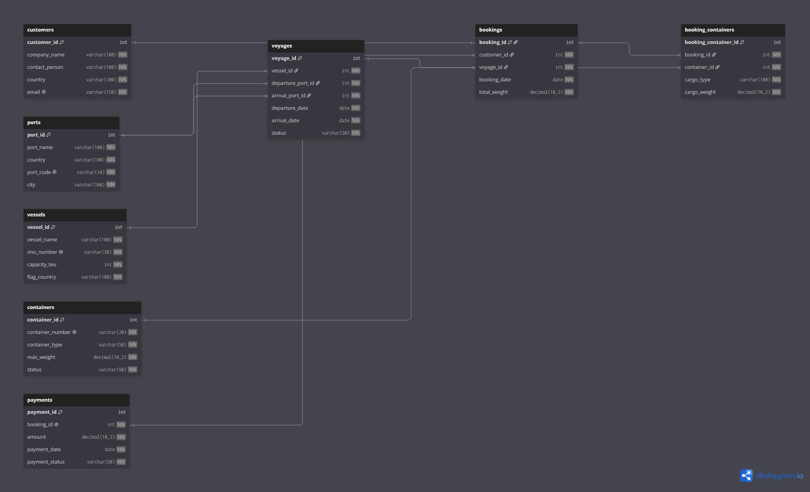
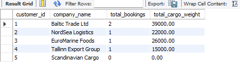
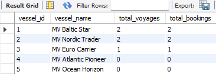
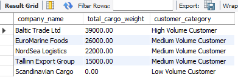
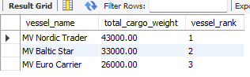

# Maritime Shipping & Voyage Management — SQL Database and Analytics

**A MySQL relational database project for maritime operations, shipping bookings, vessel activity and management reporting.**

**Project type:** Individual academic project · **Year:** 2026  
**Course:** Enterprise Data Warehouses and Database Management Systems  
**Tools:** MySQL · SQL · dbdiagram.io  
**Focus:** Relational modelling · Referential integrity · 3NF · SQL views · Aggregations · Window functions · Indexing

[View the original SQL implementation](https://github.com/myakin0/enterprisedatawarehouse/blob/main/dw_assignment_mey.sql) · [Browse the original academic repository](https://github.com/myakin0/enterprisedatawarehouse) · [Open the interactive ER diagram](https://dbdiagram.io/d/6a1c38af2eeb2f46cd26ddb8)

> **Data disclosure:** This is a small educational database populated with **synthetic illustrative records**, not live data from a shipping company. The results below demonstrate SQL business logic on the sample data; they do not measure real fleet or customer performance.

## Overview

Maritime shipping operations involve connected commercial and operational information: customers place bookings, vessels undertake voyages between ports, containers carry cargo, and payments record transactions. This project models those relationships in MySQL and demonstrates how a relational database can support structured reporting and basic business questions.

The work covers the full academic workflow: requirements assessment, schema design, normalisation, sample-data loading, integrity checks, reporting views, analytical queries and an initial review of query indexing. It also discusses the CAP theorem **conceptually** in the context of distributed maritime information systems; the implemented database itself is not a distributed system.

### Questions explored

- Which customers account for the largest booked cargo weight?
- How can customers be grouped by cargo volume while retaining those without bookings?
- Which vessels have the most recorded voyages/bookings and the highest booked cargo weight?
- How can reusable SQL views support operational and commercial reporting?
- How might indexing support a customer-to-booking join as data volumes grow?

## Data model

The schema contains **eight tables**, connected using primary keys, foreign keys and a junction table for the many-to-many booking–container relationship.



*Original ER diagram from the assignment. [View the larger interactive version on dbdiagram.io](https://dbdiagram.io/d/6a1c38af2eeb2f46cd26ddb8).*

| Table | Purpose |
| --- | --- |
| `customers` | Shipping customers and contact information |
| `ports` | Port identifiers, codes, cities and countries |
| `vessels` | Vessel identifiers, IMO-style numbers, capacity in TEU and flag country |
| `voyages` | Vessel assignments, departure/arrival ports, dates and voyage status |
| `containers` | Container identifier, type, maximum weight and availability status |
| `bookings` | Customer reservations associated with a voyage and cargo weight |
| `booking_containers` | Junction table linking bookings and containers with cargo details |
| `payments` | Payment amount, date and status for each booking |

**Design choices:**

- Primary and foreign keys model relationships and maintain referential integrity.
- Customer, vessel and port details are stored separately from bookings and voyages to limit duplication, following basic **Third Normal Form (3NF)** principles.
- `booking_containers` represents the booking–container many-to-many relationship.
- A unique booking reference in `payments` models one payment record per booking in this simplified design.
- `LEFT JOIN`-based summaries retain customers and vessels with no matching bookings or voyages.

## Implementation and validation

The original [SQL file](https://github.com/myakin0/enterprisedatawarehouse/blob/main/dw_assignment_mey.sql) contains schema creation, example `INSERT` statements, two views, and analytical queries. The report documents validation through row counts, matching foreign-key references, and inspection of the view results.

The illustrative database contains **3–5 records per table**. Its intentionally small size makes relationships and query outputs easy to examine, but it is not suitable for statistical generalisation or production-scale performance benchmarking.

### Reporting views

**1. `customer_booking_summary`** aggregates booking count and booked cargo weight by customer. It uses `LEFT JOIN` and `COALESCE` so that customers without bookings are retained with a zero weight total.



**2. `vessel_performance_summary`** reports voyages and associated bookings per vessel, retaining vessels without recorded activity.



These views provide reusable reporting outputs instead of requiring every analysis to repeat the same joins.

## SQL analytics and findings

Three analytical queries were developed and interpreted in business terms.

### 1. Customer cargo-volume analysis

An aggregate query joins customers with bookings and computes each customer's total booking count and cargo weight using `COUNT`, `SUM`, `GROUP BY` and `ORDER BY`.

In the sample, **Baltic Trade Ltd** has the highest booked cargo weight, **39,000** (sample weight units). This is an illustration of customer-contribution reporting, not a result from a real carrier.

### 2. Customer segmentation using `CASE`

A `CASE` expression classifies customers according to their aggregate cargo volume. `COALESCE` treats no-booking results as zero, rather than dropping those customers from the analysis.

| Sample-data cargo weight | Segment |
| --- | --- |
| 30,000 or more | High Volume Customer |
| 15,000–29,999.99 | Medium Volume Customer |
| Below 15,000 | Low Volume Customer |



The categories demonstrate simple, transparent rules for commercial segmentation; the thresholds were selected for the exercise and are **not validated business thresholds**.

### 3. Vessel cargo ranking using a window function

A query joins `vessels`, `voyages` and `bookings`, aggregates booked cargo weight by vessel and applies `RANK() OVER (ORDER BY SUM(...) DESC)`.



In the sample, **MV Nordic Trader** ranks first at **43,000** booked cargo-weight units, followed by MV Baltic Star (33,000) and MV Euro Carrier (26,000). These are illustrative booked-weight totals, **not measured vessel utilisation rates or actual cargo lifted**.

### Why these results matter

Taken together, the queries demonstrate how structured shipping records can support customer reporting, account segmentation and vessel-level operational summaries. The project focuses on using SQL to answer explicit business questions, rather than only demonstrating query syntax.

## Indexing and query-plan review

The report examines the customer–booking join on `bookings.customer_id`. The SQL script adds an index and the report documents checking it through `SHOW INDEX` and inspecting execution through `EXPLAIN`.

```sql
CREATE INDEX idx_bookings_customer
ON bookings(customer_id);
```


**Scope of validation:** This demonstrates index creation and execution-plan inspection. The sample database is too small to establish a meaningful speed improvement, and the report does **not** provide a controlled before/after timing benchmark. A production evaluation would require larger data, examination of existing foreign-key indexes and comparative query plans and timings.

## How to explore the project

1. Install a local **MySQL** server and use MySQL Workbench, the MySQL CLI or another compatible client.
2. Download or clone the [original source repository](https://github.com/myakin0/enterprisedatawarehouse).
3. Inspect and execute `dw_assignment_mey.sql` in a **fresh** local MySQL environment. It creates the `maritime_shipping` database, tables, demonstration records, views and queries.
4. Inspect the two views and experiment with the three analytical queries. The optional `SHOW INDEX` / `EXPLAIN` checks are documented in the report.

Example terminal commands on a system with Git and the MySQL CLI:

```bash
git clone https://github.com/myakin0/enterprisedatawarehouse.git
cd enterprisedatawarehouse
mysql -u root -p < dw_assignment_mey.sql
```

**Note:** The SQL script contains `CREATE TABLE` and `CREATE VIEW` statements without general rerun guards. Run it on a fresh database rather than repeatedly executing it against existing objects. The source includes a commented database-drop line; review SQL before uncommenting any destructive command.

## Project limitations

- **Synthetic, tiny sample:** Results demonstrate database relationships and query logic only; no real shipping-company records were used.
- **Simplified shipping processes:** One payment per booking, representative voyage records and booking–container relationships do not capture every real operational exception or commercial workflow.
- **Not a live platform:** No frontend application, live vessel feed, external integration or automated production pipeline was built for this assignment.
- **Performance not benchmarked:** Index existence and query-plan inspection were demonstrated without controlled speedup measurements.
- **CAP theorem:** Distributed-database trade-offs were discussed in the written report, not implemented or tested.

## Potential extensions

Future development could add larger datasets and constraints appropriate to actual operations, container-event history, payment status tracking, voyage delay fields, audit logs and role-based access; or connect the schema to BI dashboards. These are **ideas for future work**, not completed features.

## Sources and project context

- **Original implementation:** [`myakin0/enterprisedatawarehouse`](https://github.com/myakin0/enterprisedatawarehouse)
- **ER diagram:** [dbdiagram.io project](https://dbdiagram.io/d/6a1c38af2eeb2f46cd26ddb8)
- **Maritime data standards referenced in the report:** [DCSA Booking](https://dcsa.org/standards/booking) · [Operational Vessel Schedules](https://dcsa.org/standards/operational-vessel-schedules) · [Track & Trace](https://dcsa.org/standards/track-and-trace)
- **MySQL indexing documentation:** [How MySQL Uses Indexes](https://dev.mysql.com/doc/refman/8.0/en/mysql-indexes.html)

**Author:** Mustafa Efe Yakın  
**Academic submission:** June 2026 · Enterprise Data Warehouses and Database Management Systems

---

*This repository is a portfolio presentation of the academic work. Figures and SQL outputs are taken from the original assignment, and the runnable SQL remains linked to the original source repository.*
